# CalcAero — English screenshot gallery

The main README's `languages/en.png` now shows the 28-language picker from the
signed 1.3.1 update in PPSSPP. Its provenance and complete test frames are in
[VERIFY/UPDATE-1.3.1](../VERIFY/UPDATE-1.3.1/README.md). The 18 owner captures
below remain unchanged records of version 1.3.

These 18 screen dumps were supplied by the project owner on 10 October 2026.
They show CalcAero 1.3 with English selected. Each PNG preserves every pixel
of its original 480×272 BMP; capture notifications are retained.

The original BMP files and their hashes are archived in
[VERIFY/USER-1.3-ENGLISH](../VERIFY/USER-1.3-ENGLISH/README.md).
Earlier host previews are preserved in the repository's previous Git commit.

## Eight themes

| Theme | Theme |
|:---:|:---:|
| **Aero Blue** | **Aero Green** |
| 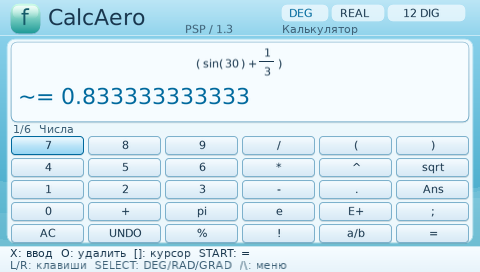 | 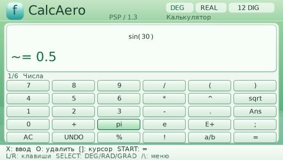 |
| **Vista Night** | **Windows XP Luna** |
| 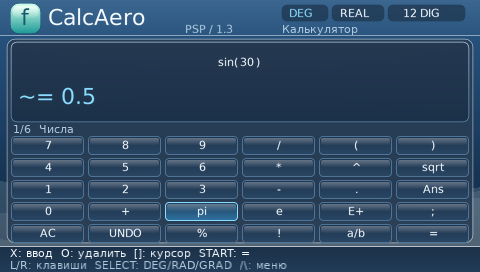 | 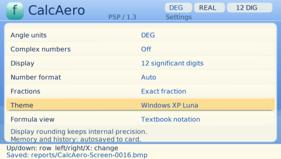 |
| **Windows Vista Aero** | **Vaporwave** |
| 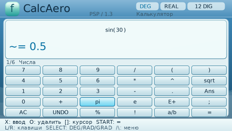 | 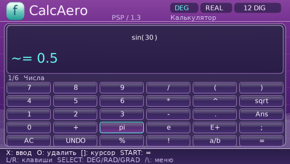 |
| **Night Retro** | **WebCore Math** |
| 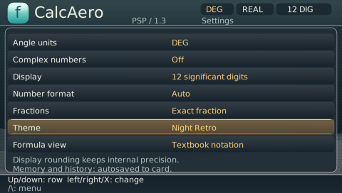 | 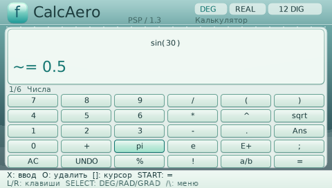 |

Seven theme captures show Settings with the theme name selected. Vaporwave
uses the Calculator capture; its purple palette matches the release's
Vaporwave preview. Each frame is a supplied screenshot, not a simulated UI.

## All 18 captures

| Screen | Screen |
|:---:|:---:|
| **Programmer mode** | **26-language picker** |
| 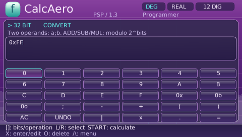 | 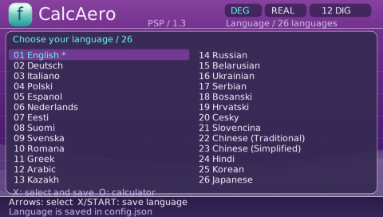 |
| **Calculator: numbers** | **Angles and logarithms** |
| 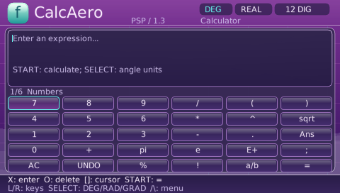 | 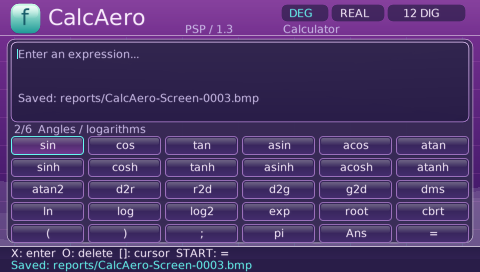 |
| **Functions** | **Memory and constants** |
| 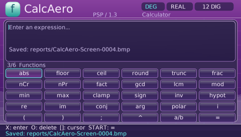 | 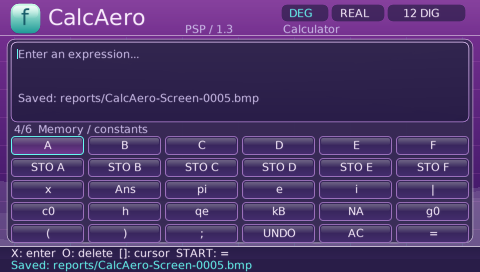 |
| **HEX and input** | **Graph keys and custom functions** |
| 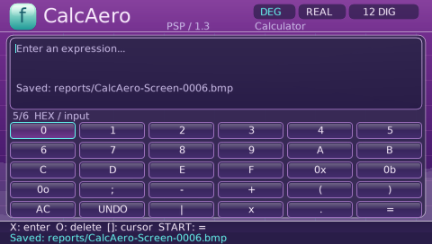 | 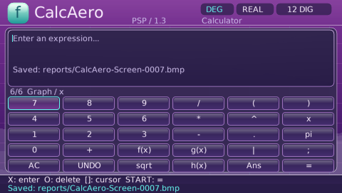 |
| **Laboratory** | **Study mode** |
| 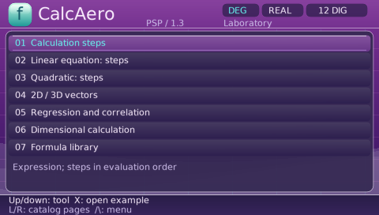 | 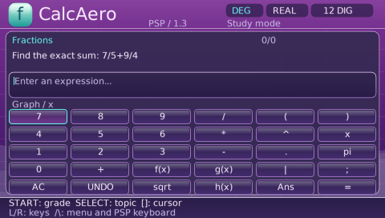 |
| **Help and controls** | **Night Retro** |
|  |  |
| **WebCore Math** | **Aero Blue** |
| 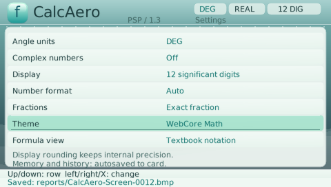 | 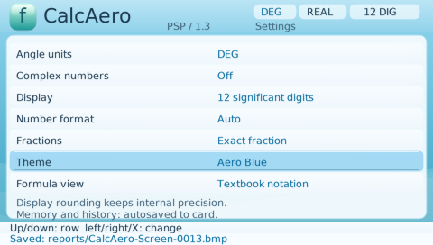 |
| **Aero Green** | **Vista Night** |
| 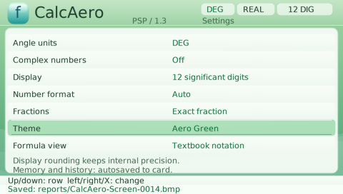 | 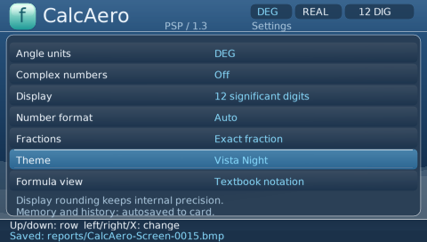 |
| **Windows XP Luna** | **Windows Vista Aero** |
|  | 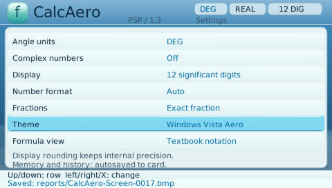 |
