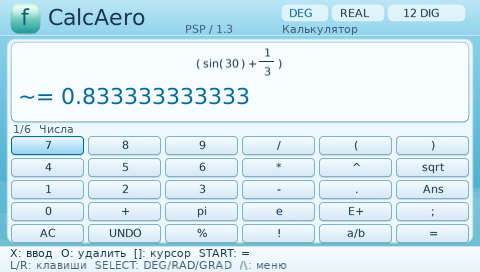

# CalcAero 1.3 — PSP

[English](README.md) · [Публикация на GitHub](GITHUB-SETUP.md)

Научный калькулятор с 26 языками, восемью оформлениями и подписанным EBOOT.
Все функции CalcAero 1.2 сохранены: точные дроби, комплексные числа, три графика,
матрицы, статистика, численные методы, Mini-CAS, размерности, формулы, учебные
задания, программист до 64 бит, история, память и экспорт.

## Установка и обновление

1. Скопируй **содержимое папки PSP** из ZIP на карту памяти PSP.
2. Если CalcAero уже установлен, объедини папки и замени EBOOT.PBP и assets.
   **Папку CalcAero целиком не удаляй**: в ней остаются твои сохранения и отчёты.
3. Запусти CalcAero в «Игра → Memory Stick»; на PSP Go выбери встроенную память,
   если приложение установлено туда.
4. На первом запуске выбери язык из всех 26 пунктов. Начальный язык — English.

Путь приложения: `PSP/GAME/CalcAero/`. Для обновления нужны **EBOOT.PBP и вся
папка assets**. Одного EBOOT недостаточно для других языков.
В устанавливаемой папке нет чужих config.json, state.dat или aero.dat.

## Язык

Если config.json отсутствует, повреждён или в нём нет допустимого language,
приложение начинает на **LANG_EN** и показывает выбор всех 26 языков.
Нажатие X/START сразу записывает выбранный код языка в config.json.
Следующий запуск использует его сразу.

В любой момент: **△ → SELECT** открывает языки. В меню также есть пункт
«Язык / 26 языков». Стрелки вверх/вниз выбирают пункт, влево/вправо — колонку.
X/START сохраняет; O возвращает калькулятор, оставляя текущий язык.
При ошибке записи выводится сообщение, а предыдущий язык сохраняется.

Поддерживаются английский, немецкий, итальянский, польский, испанский,
нидерландский, эстонский, финский, шведский, румынский, греческий, арабский,
казахский, русский, белорусский, украинский, сербский, боснийский, хорватский,
чешский, словацкий, китайский традиционный, китайский упрощённый, хинди,
корейский и японский. Таблица кодов и сведения о переводах: LOCALIZATION.md.
Имена функций, единицы SI, обозначения кнопок и математический ввод остаются
одинаковыми во всех языках. Формулы вводятся латиницей.

## Оформления

В настройках выбери строку «Тема» и нажми влево/вправо/X:
Aero Blue, Aero Green, Vista Night, **Windows XP Luna**, **Windows Vista Aero**,
**Vaporwave**, **Night Retro**, **WebCore Math**.

## PSP и официальная прошивка

В `PSP/GAME/CalcAero/EBOOT.PBP` уже лежит подписанная сборка.
Она предназначена для OFW 6.60/6.61 и CFW. Прошивка консоли не изменяется:
программа работает в User Mode и записывает данные в собственную папку.
Запрос расширенных 64 МБ отключён; частота CPU не повышается.
Пути `ms0:` и `ef0:` обрабатываются через путь запуска.

Подписанный EBOOT проверен в PPSSPP на модели PSP-1000 (32 МБ), с CPU 222 МГц
и профилями HLE 6.60/6.61. HLE не заменяет проверку загрузчиком настоящей OFW.
**Владелец проекта подтвердил работу версии 1.3 на официальной OFW 6.61
и на 6.61 ARK-5 5.1.0 cIPL (CFW).** Его сообщение сохранено в
[VERIFY/USER-1.3-OFW.md](VERIFY/USER-1.3-OFW.md).
Модель консоли для этих двух испытаний не указана. Физическая OFW 6.60 и
отдельные аппаратные испытания каждой модели PSP ещё не подтверждены.
BMP из папки VERIFY/USER-BMP сохраняются как материалы предыдущей версии 1.2.

## Сохранения и файлы

История, память и старые настройки: state.dat / state.dat.bak.
Функции, графики, матрицы и учебный счёт: aero.dat / aero.dat.bak.
Язык: config.json / config.json.bak; временный файл создаётся только на время
записи. Главный config без языка всегда приводит к English, даже если существует
старый резерв config.json.bak. Старые математические сохранения имеют прежний
формат и проверки CRC.

TXT/CSV/SVG/BMP сохраняются в reports/ с новыми именами; старые отчёты не
заменяются. Экспорт не требует сети. В корне репозитория находятся все исходники и тесты;
в VERIFY — фактические результаты, в PREVIEW — изображения интерфейса.

При возврате к 1.2 сначала выбери одну из первых трёх тем: версия 1.2 не знает
номера пяти новых тем. В UNSIGNED лежит неподписанный вариант для сборки и
сравнения; обычная установка использует подписанный файл из PSP.
