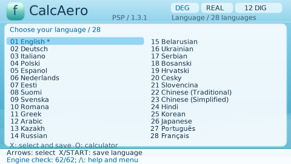
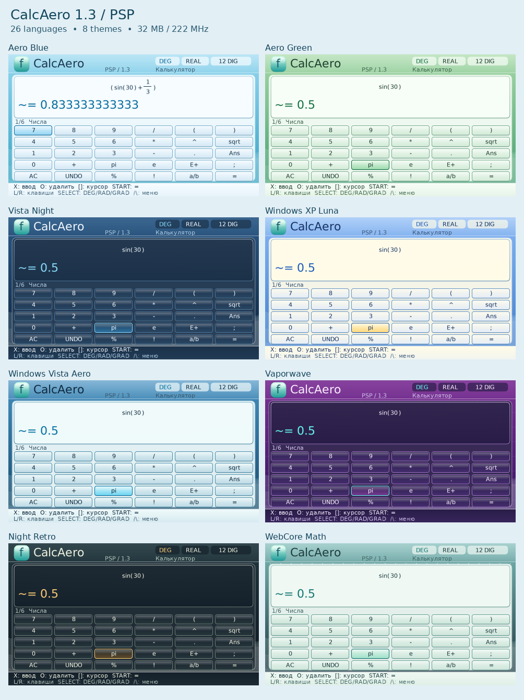
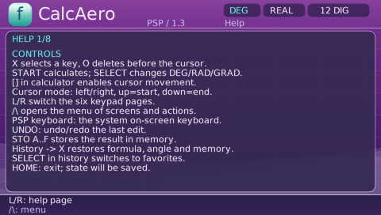

# CalcAero for PSP

**A scientific calculator with an Aero-inspired interface, 28 languages and eight themes.**

Version **1.3.1** · Native PSP application · Signed EBOOT · MIT-licensed original code

**New in 1.3.1:** Português (`pt`) and Français (`fr`), 535 messages per language, accented font
glyphs, and a 28-language picker. Existing settings and mathematical saves remain
compatible. [Release notes](RELEASE-NOTES-1.3.1.md).

| Calculate | Choose your language |
|:---:|:---:|
|  |  |

The calculator and theme gallery use real owner captures from 1.3. The updated
language picker is a native 1.3.1 PPSSPP capture; its provenance is recorded in
[the update verification](VERIFY/UPDATE-1.3.1/README.md).

[Русская документация](README-RU.md) · [Screenshot gallery](PREVIEW/README.md) · [Build from source](BUILD.md) · [Features and limits](FEATURES.md) · [Verification](VERIFY/README.md)

## Install

1. Copy the **PSP** folder from the release package to your Memory Stick or PSP Go storage.
2. Launch **Game → Memory Stick → CalcAero** (or the PSP Go storage where it is installed).
3. Choose your language. A fresh installation starts in **English** and displays all 28 choices.

The application lives in `PSP/GAME/CalcAero/`. Keep `EBOOT.PBP` and the entire
`assets` folder together. For an update, merge the folders and replace these files;
keep your existing saves and `reports` folder. The supplied installer contains no
other user's settings or saved state.

Only the `PSP` folder is needed on the console. The update ZIP also contains
`GitHub-Update`, with the changed source, documentation and verification files
for merging into the existing repository on your computer.

## What it can do

- Exact fractions, complex numbers, scientific functions and numerical calculus.
- Three colored graphs, roots, intersections, local extrema and data tables.
- Matrices up to 4×4, equations, 2D/3D vectors, statistics and regression.
- Unit conversion, dimensional arithmetic and a 12-formula library.
- A programmer mode with 8/16/32/64-bit operations and IEEE 754 inspection.
- Saved custom functions, bounded Mini-CAS, practice exercises and explanations.
- History, memory, favorites and UTF-8 TXT, CSV, SVG and BMP exports.

Mathematical and numerical limits are documented in [FEATURES.md](FEATURES.md).

## 28 languages

English, Deutsch, Italiano, Polski, Español, Nederlands, Eesti, Suomi, Svenska,
Română, Ελληνικά, العربية, Қазақша, Русский, Беларуская, Українська, Српски,
Bosanski, Hrvatski, Čeština, Slovenčina, 繁體中文, 简体中文, हिन्दी, 한국어, 日本語, Português and Français.

If `config.json` is absent or does not contain a valid language, CalcAero starts
with `LANG_EN`. Selecting a language saves it immediately; subsequent launches
use that choice. **Triangle → SELECT** opens the language picker at any time.

Catalogs and fonts are included. Translation provenance and opportunities for
native-speaker review are described in [LOCALIZATION.md](LOCALIZATION.md).

## Eight themes

| Original themes | Added in 1.3 |
|---|---|
| Aero Blue | Windows XP Luna |
| Aero Green | Windows Vista Aero |
| Vista Night | Vaporwave |
| | Night Retro |
| | WebCore Math |



Real screenshots supplied by the project owner, shown in English. Each 480×272
frame is preserved unchanged. [Browse all 18 captures](PREVIEW/README.md).

## Firmware and hardware reports

The project owner reports successful operation of **version 1.3** on:

| Firmware | Result | Evidence |
|---|---|---|
| Official firmware **6.61** | Owner-reported pass | [User confirmation](VERIFY/USER-1.3-OFW.md) |
| **6.61 ARK-5 5.1.0 cIPL** | Owner-reported pass | [User confirmation](VERIFY/USER-1.3-OFW.md) |

The signed build targets OFW 6.60/6.61 and CFW. The application uses User Mode,
does not raise the CPU clock, and does not request the 64 MiB memory expansion.
The supplied automated runtime reports cover PPSSPP's PSP-1000/32 MiB model at
222 MHz and HLE firmware profiles 6.60/6.61. Separate physical tests for OFW 6.60
and every PSP model are not recorded. **The 1.3.1 update has not yet received a
physical console test report.** See [OFW.md](OFW.md) for the audit details.

## English interface in use

| Programmer mode | Laboratory |
|:---:|:---:|
|  |  |

| Study mode | Help and controls |
|:---:|:---:|
|  |  |

## Verification included

The original release reports contain **25,415 numerical checks** and **1,694 UI
states**. They are preserved under `VERIFY`; hardware reports are recorded
separately. Fresh 1.3.1 reports and emulator screenshots are kept in
[VERIFY/UPDATE-1.3.1](VERIFY/UPDATE-1.3.1/README.md).
See [verification notes](VERIFY/README.md).

## Build and contribute

Source code is at the repository root: `src`, `assets`, `tests`, `vendor` and
`Makefile`. With the documented PSP toolchain:

```sh
make -j2
make EBOOT-SIGNED.PBP
```

[BUILD.md](BUILD.md) describes dependencies and tests. [CONTRIBUTING.md](CONTRIBUTING.md)
explains useful bug reports and translation contributions. To publish this
prepared Git repository, follow [GITHUB-SETUP.md](GITHUB-SETUP.md).

## License

Original CalcAero code uses the [MIT license](LICENSE). Fonts, bundled libraries
and shared helpers retain their own notices in [LICENSES](LICENSES) and
[THIRD-PARTY.md](THIRD-PARTY.md). CalcAero is an independent PSP homebrew project.
